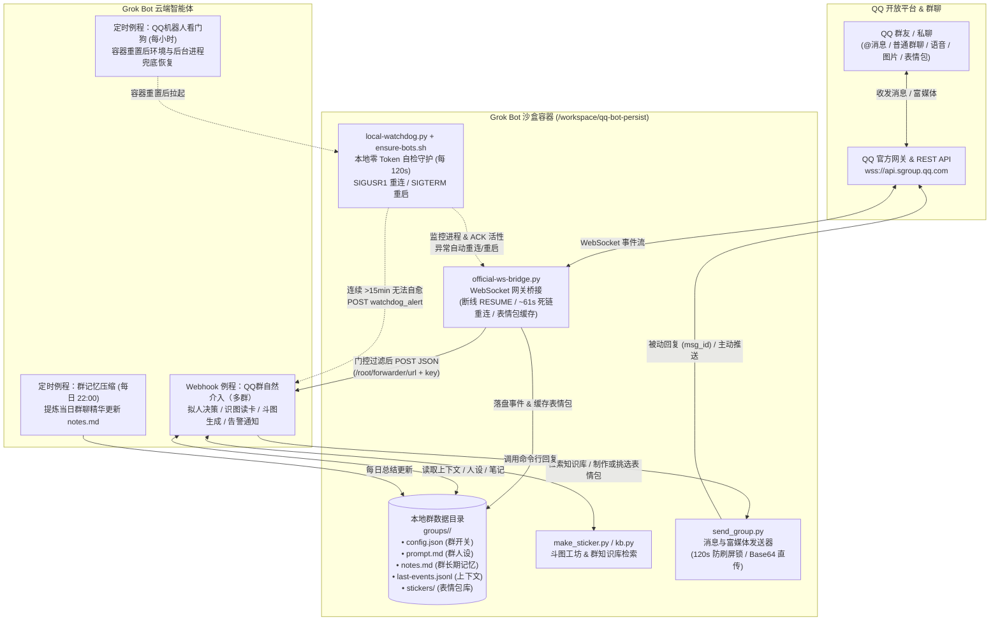

# MaxShenBi QQ 官方机器人（Grok Bot 专属版）

2026-10-28 更新：[消息格式、并发去重、例程约束与许可表情素材包](official-bot/REPLY_STYLE.md)。新增 20 张 OpenMoji 反应图及 20 个改字模板，可离线安装；真实群数据仍不入 Git。


基于 **QQ 开放平台官方机器人 API v2 + WebSocket 网关** 打造的多群拟人化 AI 机器人套件，专为 **Grok Bot** 云端沙盒环境设计。无需安装桌面版 QQ 或 NapCat，保留原有部署和 CLI 方式，提供多群独立人设、富媒体/语音/Markdown 收发、群专属知识库、**斗图表情包工坊**以及**本地零 Token 自愈守护**。

---

## 本次分层升级

原 CLI 参数继续兼容，新增群级插件、持久化投递与记忆存储、本机管理后台。
完整模块边界见 [ARCHITECTURE.md](official-bot/ARCHITECTURE.md)，升级、备份和回退步骤见
[MIGRATION.md](official-bot/MIGRATION.md)。先安装 `official-bot/requirements.txt`，再运行原启动命令。

```bash
python3 tools/check.py
python3 official-bot/dashboard.py --port 8787
```

后台仅监听本机；用终端显示的一次性登录码登录。数据库、真实群注册表、配置、聊天记录、
真实群图片和密钥保留本机；仅经过许可审核的公共素材包入 Git。消息发送的 `unknown` 状态需要核实远端结果，不能直接盲重发。

## ✨ 核心特性

1. **使用官方协议**
   - 直接连接 QQ 开放平台官方 WebSocket 网关（`wss://api.sgroup.qq.com/websocket`），无需第三方 QQ 客户端；平台权限和限额仍以实际开放能力为准。
   - 网关内置 **`op=6 RESUME` 断线补收事件**、**约 61 秒独立看门狗死链重连**、**TCP Keepalive**、**HTTP 401 自动清理并换新 Token**，以及**异步工作线程转发**（绝不阻塞网关收发心跳）。
2. **专为 Grok Bot 环境深度定制**
   - 网关收到群聊/私聊/互动事件后，自动解析引用、图片、语音 ASR 文本、分享卡片与自定义表情包，组装成结构化 JSON 通过 **Webhook** 唤醒 **Grok Bot 例程（Routine）**。
   - Grok Bot 结合群历史上下文（`last-events.jsonl`）、群专属人设（`prompt.md`）与群长期记忆（`notes.md`）进行拟人化推理，再调用 `send_group.py` 完成回复。
3. **多群隔离管理与专属知识库**
   - 一个机器人可同时服务多个 QQ 群，每个群拥有独立的开关配置（`config.json`）、专属人设（`prompt.md`）、长期记忆笔记（`notes.md`）与文档知识库（`knowledge/`）。
   - 支持通过 `kb.py` 检索群内 Markdown / TXT / PDF 文档或同步公开 GitHub 仓库，查询、插件状态和媒体按群作用域管理。
4. **斗图表情包工坊（`make_sticker.py`）**
   - **群聊表情包自动收藏**：网关自动识别群友发送的自定义表情包并缓存至本群 `stickers/` 目录，在消息文本中标注是否已入库。
   - **内容去重入库与标签关键词检索**：支持将群友新图去重入库（`--add-sticker`），并按情绪、角色、热梗关键词检索（`--pick` / `--search`），内置最近 25 次防重复记忆。
   - **模板动态加字 & GIF 动效**：使用部署时另行配置的底图动态排版加字（图片资源不在此代码仓库内），一键生成 `shake`（震动）、`zoom`（冲屏）、`bounce`（弹跳）动图。
5. **混合双层看门狗自愈架构（零 Token 巡检 + 云端兜底）**
   - **第一层（本地零 Token 守护 `local-watchdog.py`）**：每 120 秒在容器内静默自检，消耗 **0 LLM Token**。内置**沙盒休眠唤醒防误杀机制**（检测到容器冻结唤醒后先给网关 25 秒宽限期完成 `RESUME` 补收积压消息，且唤醒后首次恢复动作强制降级为 `SIGUSR1` 热重连而非强杀）；日常超过 8.5 分钟无心跳/ACK 信号发 `SIGUSR1` 热重连，超过 11 分钟发 `SIGTERM` 重启；仅当连续故障超过 **15 分钟**仍未恢复时，才通过 Webhook 发送 `watchdog_alert` 唤醒云端通知主人。
   - **第二层（Grok Bot 外部定时兜底例程）**：示例按每小时检查并调用 `ensure-bots.sh`；实际频率由部署环境决定。本仓库不保证平台容器永不休眠。
6. **白名单 Git 与预提交隐私扫描（`tools/secret-scan.sh`）**
   - `.gitignore` 采用严格白名单机制，所有密钥、`openid`、QQ 号、群聊记录、笔记与图库文件均排除在版本控制之外，配合只报告位置、不回显命中内容的 `secret-scan.sh` 检查提交。

---

## 🏗️ 外部 Grok 例程兼容链路

新 core、持久化队列及后台的职责见上述架构文档；下图说明继续保留的外部调用方式。



---

## 🚀 在 Grok Bot 中 5 分钟快速安装与使用指南

### 第一步：在 QQ 开放平台创建机器人

1. 前往 [QQ 开放平台](https://q.qq.com) 登录并创建一个**机器人**应用。
2. 在「开发设置」中获取机器人的 **`AppID`** 和 **`AppSecret`**，并记下机器人的 **QQ 号**。
3. **⚠️ 重要：IP 白名单请保持留空**（或在开启白名单时确保随时同步），因为 Grok Bot 云端沙盒容器的出口 IP 可能会随容器轮换而变化，固定死白名单会导致发送消息报错。
4. 在「事件订阅 / 权限配置」中开启群消息相关事件（`GROUP_AT_MESSAGE_CREATE` 群艾特消息、如有权限可同时开启 `GROUP_MESSAGE_CREATE` 群全量消息、`C2C_MESSAGE_CREATE` 单聊消息与 `INTERACTION_CREATE` 互动事件，对应默认 `intents = 117440512`）。
5. 在「沙箱配置」中添加测试 QQ 群，并将机器人拉入你的 QQ 群中。

---

### 第二步：在 Grok Bot 容器中克隆仓库并安装依赖

在 Grok Bot 对话框中让助手执行（或在容器终端中运行）以下命令，将代码克隆到固定路径 `/workspace/qq-bot-persist` 并安装 Python 依赖：

```bash
# 1. 克隆仓库到 /workspace/qq-bot-persist
git clone https://github.com/zard110/maxshenbi-qqbot.git /workspace/qq-bot-persist
cd /workspace/qq-bot-persist

# 2. 安装 WebSocket 客户端与图片处理依赖（Pillow 用于斗图工坊生成表情包）
sudo python3 -m pip install --break-system-packages websocket-client pillow

# 3. 挂载 Git 提交前隐私安全扫描钩子（防止误提交密钥）
ln -sf ../../tools/secret-scan.sh .git/hooks/pre-commit
```

---

### 第三步：创建 Grok Bot Webhook 例程并写入本地密钥

1. 在 Grok Bot 界面创建一个 **Webhook 触发** 的例程（Routine），命名为 `QQ群自然介入（多群）`。
2. 创建后会生成专属的 **Webhook URL** 和 **Webhook Bearer Key**。
3. 按照 [official-bot/secrets.example.md](official-bot/secrets.example.md) 将密钥写入本地文件（权限设为 `600`，均已被 `.gitignore` 忽略）：

```bash
cd /workspace/qq-bot-persist

# 1. 写入 QQ 开放平台凭证
echo -n "你的AppID" > official-bot/appid
echo -n "你的AppSecret" > official-bot/appsecret
echo -n "机器人QQ号" > official-bot/bot_uin.txt
echo -n "机器人昵称" > official-bot/bot_name.txt

# 2. 写入 Grok Bot Webhook 地址与密钥（持久化保存在仓库根目录，开机脚本会自动同步到 /root/forwarder/）
echo -n "你的Webhook_URL" > forwarder-url
echo -n "你的Webhook_Key" > forwarder-key

# 3. 收紧密钥文件权限并同步到 /root/forwarder/
chmod 600 official-bot/appid official-bot/appsecret forwarder-url forwarder-key
sudo mkdir -p /root/forwarder
sudo cp forwarder-url /root/forwarder/url
sudo cp forwarder-key /root/forwarder/key
sudo chmod 600 /root/forwarder/url /root/forwarder/key

# 4. 验证 AppID 与 AppSecret 是否能正常换取官方 Access Token
python3 /workspace/qq-bot-persist/official-bot/send_group.py --dry-credentials
```

看到输出 `credential check OK: token len=...` 即表示 QQ 官方接口鉴权成功！

---

### 第四步：一键启动网关与本地守护进程

运行仓库根目录下的 `ensure-bots.sh`，它会自动同步脚本并后台启动 WebSocket 网关桥接（`official-ws-bridge.py`）与本地零 Token 守护（`local-watchdog.py`）：

```bash
sudo bash /workspace/qq-bot-persist/ensure-bots.sh
```

查看网关日志确认连接成功：

```bash
tail -n 20 /workspace/qq-bot-persist/official-bot/official-ws-bridge.log
```

当日志中出现 `READY session=...` 且心跳显示 `ack ok` 时，说明机器人已成功接入 QQ 官方网关！

---

### 第五步：在群里 `@机器人` 自动初始化群配置与人设

1. 在已添加机器人的 QQ 群里发送一条 `@机器人 你好`。
2. 网关收到消息后，会自动创建该群的专属目录 `official-bot/groups/<GROUP_OPENID>/`，并生成默认的 `config.json`、`prompt.md`、`notes.md` 和 `knowledge/` 目录。
3. 查看日志中的 `NEW GROUP auto-created: <GROUP_OPENID>` 获取该群的 `group_openid`，将其设为默认群（可选）：
   ```bash
   echo -n "<GROUP_OPENID>" > /workspace/qq-bot-persist/official-bot/group_openid.txt
   ```
4. 编辑 `official-bot/groups/<GROUP_OPENID>/config.json` 自定义群别名和功能开关：
   ```json
   {
     "name": "我的主力群",
     "aliases": ["main"],
     "group_openid": "<GROUP_OPENID>",
     "enabled": true,
     "features": {
       "natural_reply": true,
       "at_reply": true,
       "daily_ai_news": true,
       "x_info_push": false,
       "image_gen": true,
       "buttons": true,
       "welcome": true,
       "media_understanding": true,
       "knowledge": true
     },
     "style": "详见 prompt.md"
   }
   ```
   - `at_reply`: 被 `@` 时是否回复（默认开启）。
   - `natural_reply`: 未被 `@` 时是否将群消息转发给 Grok Bot 例程判断自然插话（开启后机器人能像真实群友一样顺着话题接梗）。
   - 修改 `config.json` 或 `prompt.md` 后**立即生效**，无需重启网关。

---

## 🤖 Grok Bot 配套例程（Routines）配置指南

为了让机器人在 Grok Bot 中发挥完整实力，建议配置以下 **3 个核心例程**：

### 1. Webhook 例程：`QQ群自然介入（多群）`（核心对话与告警处理）

- **触发方式**：Webhook 触发（将 URL 和 Key 填入上文 `forwarder-url` 和 `forwarder-key`）。
- **核心职责与提示词要点**：
  1. **看门狗告警优先分支**：如果收到的 Webhook JSON 中 `post_type == "watchdog_alert"`，说明本地守护进程 `local-watchdog.py` 连续 15 分钟以上未能修复网关连接。立即执行 `sudo bash /workspace/qq-bot-persist/ensure-bots.sh` 并检查 `official-ws-bridge.log`，向主人汇报故障原因与修复结果（不要往 QQ 群发消息）。
  2. **读取本群配置与人设**：从 payload 中读取 `group_openid`、`group_dir`、`features`、`msg_id`、`at_me`、`raw_message`；先读 `<group_dir>/prompt.md`（本群专属人设）和 `<group_dir>/notes.md`（本群长期记忆），再查看 `<group_dir>/last-events.jsonl` 最近 25 条群聊上下文。
  3. **自然介入判断**：
     - 若 `at_me == true`：必回，直接正面回应群友问题（若带图片 URL 则下载识图，若带语音 ASR 则直接回答）。
     - 若 `at_me == false`：作为同好群友评估是否值得插话（有明确事实问题、求推荐、能接上高质量群梗时才回；闲聊刷屏或 120 秒内刚发过言则安静退出）。
  4. **新表情包自动入库**：若 `raw_message` 含 `[表情包(未入库): .../stickers/xxx.gif | url=...]`，下载查看图片内容后调用 `make_sticker.py --add-sticker` 归档入库。
  5. **去重与发送**：透传 `reply_context` 的 source/action/trigger/topic 字段，一事件一次 CLI 调用，重投不加 `--force`；按 [回复约定](official-bot/REPLY_STYLE.md) 设置格式和表情节奏。**发送回复**：优先带上 `--msg-id "<msg_id>"` 走被动回复通道，支持文字、Markdown 或斗图工坊生成的表情包。

### 2. 每小时定时例程：`QQ机器人看门狗`（容器重置零干预兜底）

- **触发方式**：定时 Cron `0 * * * *`（每小时整点运行）。
- **为什么需要它**：日常网关断线由本地 `local-watchdog.py` 每 120 秒零 Token 自愈处理；但当云端沙盒容器发生整机重置时，所有后台进程和 `/root/forwarder` 会被清空，此时需要云端 Cron 例程把环境拉起来。
- **执行逻辑**：
  ```bash
  # 静默单条命令快速自检：若转发配置、网关进程、本地看门狗都在且 15 分钟内有活跃日志，直接退出
  test -s /root/forwarder/url && test -s /root/forwarder/key \
    && [ "$(pgrep -fc 'official-ws-bridge.py')" -eq 1 ] \
    && [ "$(pgrep -fc 'local-watchdog.py')" -eq 1 ] \
    || sudo bash /workspace/qq-bot-persist/ensure-bots.sh
  ```

### 3. 每日定时例程：`群记忆压缩`（长期记忆沉淀）

- **触发方式**：定时 Cron `0 22 * * *`（每天 22:00 运行）。
- **执行逻辑**：遍历 `official-bot/groups/<group_openid>/`，阅读当日 `last-events.jsonl` 中的群聊热点、群友新装备/新梗/重要约定，通过记忆服务或后台提交带来源的摘要。旧 `notes.md` 可导入，迁移后不要让外部例程覆盖数据库中的人工修改。

---

## 🛠️ 常用命令速查表

所有脚本均位于 `/workspace/qq-bot-persist/official-bot/` 目录下：

### 1. 发送群聊 / 私聊消息（`send_group.py`）

```bash
cd /workspace/qq-bot-persist/official-bot

# 查看目标群最近发送记录与 120 秒冷却状态（发消息前必查）
python3 send_group.py --group main --recent

# 被动回复群消息（日常文字回复默认推荐 --text 即 msg_type=0，防客户端吞长 Markdown，自动将 <qqbot-at-user> 转为 <@openid>）
python3 send_group.py --group main --text "收到！这是回复内容" --msg-id "ROBOT1.0_xxx"

# 单条消息同时发本地图片 + 真实 @（自动上传 /v2/media-images 获取 qqbot-media:// 并合成单条 msg_type=2 发送）
python3 send_group.py --group main --image /tmp/card.png --text "<@MEMBER_OPENID> 今日战报" --msg-id "ROBOT1.0_xxx"

# 引用某条具体消息并回复（使用收到消息的 ref_idx 字段）
python3 send_group.py --group main --markdown "针对这条消息的补充" --reply-to "REFIDX_xxx" --msg-id "ROBOT1.0_xxx"

# 发送图片 / 表情包（支持 jpg/png/gif，本地文件 ≤5MB 自动 Base64 直传）
python3 send_group.py --group main --image /tmp/meme.gif --msg-id "ROBOT1.0_xxx"

# 图文同发（图片 + 简短说明在同一条消息内）
python3 send_group.py --group main --image /tmp/card.png --text "今日排行榜" --msg-id "ROBOT1.0_xxx"

# 发送语音条（支持 mp3/wav/silk，自动转码上传）
python3 send_group.py --group main --voice /tmp/news.mp3

# 挂载底部互动按钮（配合 --markdown 使用）
python3 send_group.py --group main --markdown "## 🚴 今天打卡了吗？" --keyboard @keyboards/checkin.json

# 撤回 2 分钟内机器人自己发出的消息（消息 ID 可在 sent-log.jsonl 中查看）
python3 send_group.py --group main --recall "ROBOT1.0_xxx"

# 突破 120 秒防刷屏冷却（仅在被群友连续 @ 追问或紧跟斗图时使用）
python3 send_group.py --group main --markdown "补充说明..." --msg-id "ROBOT1.0_xxx" --force

# 回复私聊消息（C2C）
python3 send_group.py --user-openid "<USER_OPENID>" --markdown "你好！" --msg-id "<MSG_ID>"
```

### 2. 斗图表情包工坊（`make_sticker.py`）

```bash
cd /workspace/qq-bot-persist/official-bot

# 1. 从本群现有图库和模板搜索候选（数量以 index.json 为准）
python3 make_sticker.py --search "拉爆 功率 吹牛"

# 2. 按关键词/角色/情绪直接抽取一张现成表情包（自动避开最近用过的 25 张，支持 --prefer-gif）
python3 make_sticker.py --pick "二哈 鄙视" --prefer-gif

# 3. 用指定或随机模板动态加字生成静态梗图（支持 | 分隔上下两行字）
python3 make_sticker.py --template husky_disdain --text "就这功率？|连我奶奶散步都不如" --out /tmp/meme.jpg

# 4. 生成带动态特效的 GIF 表情包（支持 shake 震动 / zoom 冲屏 / bounce Q弹）
python3 make_sticker.py --template pepe_smug --animate shake --text "看破不说破|继续听你吹" --out /tmp/meme.gif

# 5. 将群友发的新表情包去重入库（自动校验 SHA-256 防止重复收录）
python3 make_sticker.py --add-sticker stickers/xxx.gif --text "熊猫头双手抱拳：大佬受我一拜" --category panda --tags "熊猫头,大佬,佩服,抱拳"

# 6. 查看当前完整表情包索引与模板列表
python3 make_sticker.py --list
```

### 3. 群专属知识库管理（`kb.py`）

```bash
cd /workspace/qq-bot-persist/official-bot

# 搜索指定群知识库中的文档（支持 md / txt / pdf，PDF 自动提取文本缓存）
python3 kb.py --group main search "FTP 测试"

# 输出 JSON 格式搜索结果（便于脚本调用）
python3 kb.py --group main search "训练计划" --json

# 同步该群 config.json 中配置的公开 GitHub 仓库到 knowledge/repos/
python3 kb.py --group main sync

# 向该群知识库添加本地文档（md / txt / pdf）
python3 kb.py --group main add-doc /path/to/guide.pdf

# 列出该群当前所有知识库文档与仓库状态
python3 kb.py --group main list
```

---

## 📂 目录结构说明

```text
/workspace/qq-bot-persist/
├── README.md                        # 项目主文档（本文档）
├── ensure-bots.sh                   # 容器启动/重置自愈脚本（补装依赖、同步配置、拉起网关与看门狗）
├── .gitignore                       # 白名单式 Git 忽略规则（严格排除密钥与群聊隐私数据）
├── tools/
│   └── secret-scan.sh               # Git 提交前与全库敏感信息扫描器（拦截密钥/QQ号/openid/非白名单URL）
└── official-bot/
    ├── README.md                    # official-bot 模块说明文档
    ├── USAGE.md                     # send_group.py 详细参数与 Webhook Payload 字段手册
    ├── MULTIGROUP.md                # 多群隔离架构、配置开关与群人设说明
    ├── secrets.example.md           # 本地密钥与身份文件恢复清单
    ├── docs-explore.md              # QQ 官方 API v2 能力实测与接口探索笔记
    ├── official-ws-bridge.py        # 核心：QQ 官方 WebSocket 网关桥接器
    ├── run-official-ws.sh           # 网关守护循环启动脚本
    ├── local-watchdog.py            # 核心：本地零 Token 守护进程（每 120s 自检自愈）
    ├── run-local-watchdog.sh        # 本地看门狗循环启动脚本
    ├── send_group.py                # 核心：多群消息/富媒体/语音/按钮发送与撤回工具
    ├── make_sticker.py              # 核心：斗图表情包工坊（模板加字、GIF 动效、检索与入库）
    ├── groups.py                    # 多群注册表与配置解析模块
    ├── kb.py                        # 多群本地文档与 GitHub 仓库知识库检索工具
    ├── intents.txt                  # WebSocket 订阅权限位值（117440512）
    ├── keyboards/                   # 互动按钮 JSON 模板示例（打卡、答题回调）
    ├── tests/
    │   └── intent_probe.py          # WebSocket intents 权限探测脚本
    └── groups/
        ├── config.example.json      # 群配置文件完整示例
        ├── _default/                # 新群自动初始化默认模板
        │   ├── config.json          # 新群默认开关配置（默认仅开启 @ 回复）
        │   └── prompt.md            # 新群默认人设模板
        └── <GROUP_OPENID>/          # 实际运行时的各个群目录（不进 Git）
            ├── config.json          # 本群独立开关与别名配置
            ├── prompt.md            # 本群专属人设与说话风格
            ├── notes.md             # 本群长期记忆笔记
            ├── knowledge/           # 本群专属知识库文档与同步仓库
            ├── stickers/            # 本群表情包图库、模板与 index.json
            ├── last-events.jsonl    # 本群实时消息事件流（上下文）
            └── sent-log.jsonl       # 本群已发送消息日志（防重复与撤回凭据）
```

---

## 🔒 安全与隐私脱敏机制

本仓库设计了**双重隐私防线**，确保你可以放心地将代码推送到公开或私有 GitHub 仓库：

1. **`.gitignore` 白名单模式**：
   - 默认忽略所有文件（`*`），仅显式放行 `.py`、`.sh`、`.md`、模板配置与测试脚本。
   - 所有的本地密钥（`appid`、`appsecret`、`forwarder-url`、`forwarder-key`）、群目录（`groups/<GROUP_OPENID>/`）、聊天记录（`*.jsonl`）、运行日志（`*.log`）和实际群表情包图片均不会进入 Git（已审核公共素材包除外）。
2. **`tools/secret-scan.sh` 自动化扫描**：
   - 在每次 `git commit` 时自动检查暂存区（也可随时手动运行 `bash tools/secret-scan.sh --tracked` 扫描全库）。
   - 自动读取本机真实密钥文件进行字面量比对（不打印明文），并拦截任何 32 位十六进制 `openid`、9~11 位数字（QQ 号 / AppID）、Token 串、邮箱地址以及未列入白名单的 Webhook URL。

```bash
# 手动对全库已跟踪文件执行一次完整脱敏扫描
bash /workspace/qq-bot-persist/tools/secret-scan.sh --tracked
```

---

## 📖 进阶文档导航

- 📘 **[send_group.py 发送参数与 Webhook 字段手册 (official-bot/USAGE.md)](official-bot/USAGE.md)**：详细了解图文混排、语音发送、引用回复、按钮键盘以及网关转发给 Grok Bot 的 JSON 字段结构。
- 📗 **[多群架构与专属知识库指南 (official-bot/MULTIGROUP.md)](official-bot/MULTIGROUP.md)**：了解如何让一个机器人同时服务多个 QQ 群、配置群专属 `prompt.md` 人设与管理群知识库。
- 🔑 **[本地密钥恢复清单 (official-bot/secrets.example.md)](official-bot/secrets.example.md)**：迁移环境或克隆仓库后需要手动放置的密钥文件一览表。
- 🧪 **[QQ 官方 API v2 探索与实测笔记 (official-bot/docs-explore.md)](official-bot/docs-explore.md)**：官方接口限额、富媒体直传、WebSocket Intents 探测等底层技术细节。
